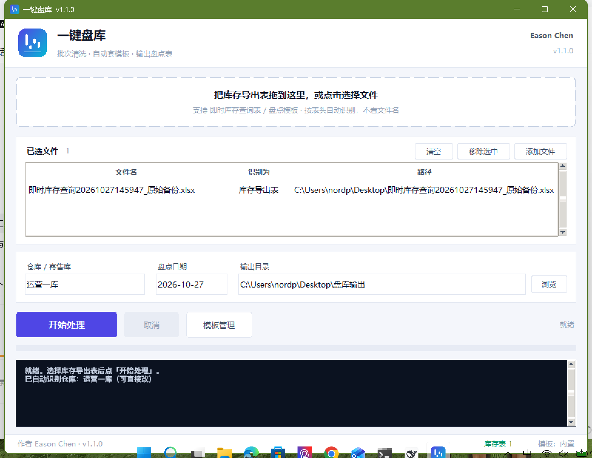
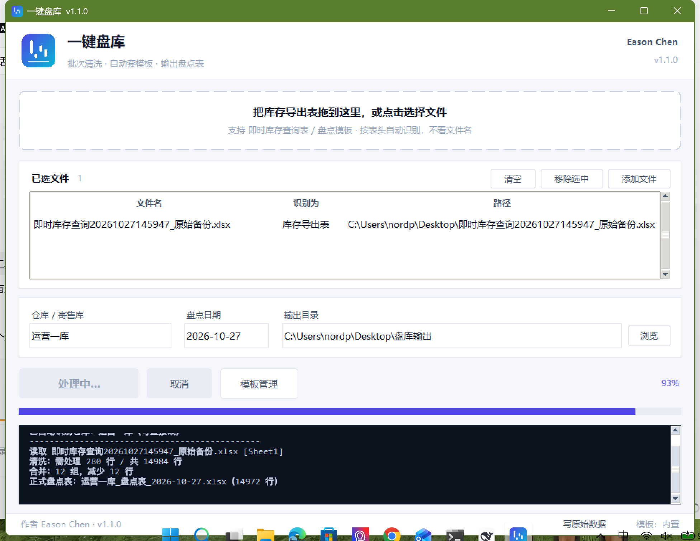
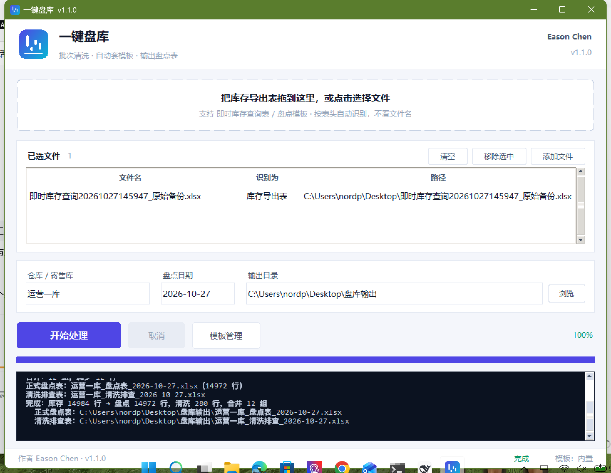
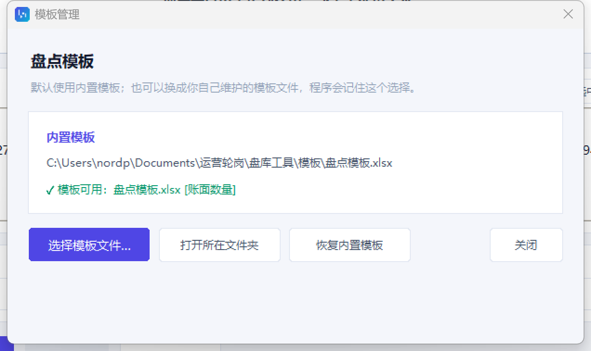
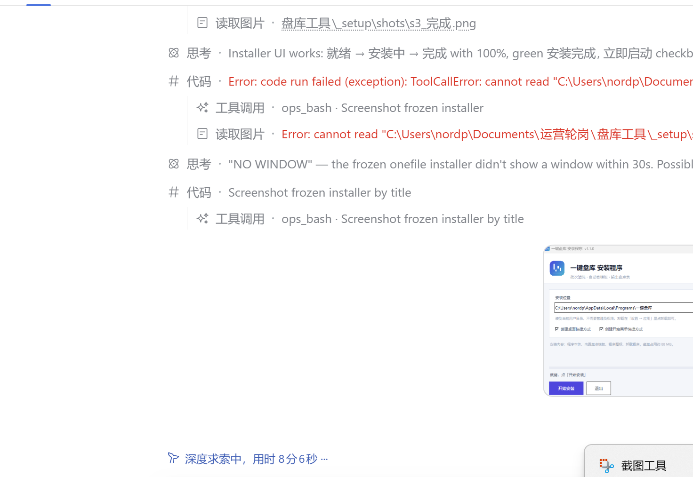

# 一键盘库

> 批次号清洗 + 自动套盘点模板，把 ERP 导出的即时库存表一键变成可打印的寄售库盘点表。
> 作者：Eason Chen · 版本：v1.1.0

## 下载

| 版本 | 文件 | 说明 |
|---|---|---|
| 安装版 | [一键盘库_安装程序_v1.1.0.exe](https://github.com/nordpolc/yijianpanku/releases/download/v1.1.0/%E4%B8%80%E9%94%AE%E7%9B%98%E5%BA%93_%E5%AE%89%E8%A3%85%E7%A8%8B%E5%BA%8F_v1.1.0.exe) | 双击安装到 `%LOCALAPPDATA%\Programs\一键盘库`，带桌面/开始菜单快捷方式与卸载项 |
| 免安装版 | [一键盘库_免安装版_v1.1.0.zip](https://github.com/nordpolc/yijianpanku/releases/download/v1.1.0/%E4%B8%80%E9%94%AE%E7%9B%98%E5%BA%93_%E5%85%8D%E5%AE%89%E8%A3%85%E7%89%88_v1.1.0.zip) | 解压即用，整文件夹拷走即可，`_internal` 不能删 |

全部版本见 [Releases](https://github.com/nordpolc/yijianpanku/releases)。



## 这个工具解决什么问题

寄售库盘点前要拿 ERP 导出的《即时库存查询》去填公司的《产成品盘点表》。手工做有三处坑：

1. **批次号格式乱**：同一个批次在不同单据上可能带字母前缀、带备注、用全角斜杠，直接按批次匹配会漏行；
2. **纯数字批次号被 Excel 当数字**：格式不一致就匹配不上，整批漏盘；
3. **一万多行手工填表**：既要写数量、又要算差异、还要留盘盈盘亏的痕迹。

工具把这三步做成一条流水线：**识别表格 → 清洗批次号 → 合并重复 → 套模板出盘点表**，全程 20 秒左右，并且把所有改动过的行原样留痕，便于事后排查。

## 功能

- **自动认表**：按表头指纹识别文件角色（库存导出表 / 盘点模板），不看文件名；支持多文件同时拖入。
- **批次号清洗**：把任意写法的批次号归一到三种形态——纯数字、纯数字+一位字母、空或 \（规则见下）。
- **重复合并**：物料编码、规格型号、仓库、库存类型、库存状态、批次、生产日期、到期日期等 10 个字段全相同才合并，同批次不同日期不合并。
- **套模板出表**：把数据填进内置盘点模板，序号、账面数量、差异公式、总计、冻结窗格、打印标题一次到位，物料编码和批次列强制文本格式。
- **留痕排查**：另出一份排查工作簿，含原始数据、清洗后数据、ROW_DATA（每一条被改动的行 + 原值 + 清洗动作）、清洗规则说明、合并明细。
- **可换模板**：界面里可以导入自己改过的盘点模板，存在 `%APPDATA%\一键盘库\模板\`，随时可恢复内置模板。
- **输出目录兜底**：目标目录不可写（被占用 / 权限不足）时自动改到桌面，文件名被占用时自动加时间戳，不会白跑 20 秒。

## 界面

| 处理中 | 完成 |
|---|---|
|  |  |

| 模板管理 | 安装程序 |
|---|---|
|  |  |

## 批次号清洗规则

清洗后只保留三种形态：

1. 纯数字，例如 `230290026`
2. 纯数字 + 一位英文字母，例如 `230290026T`
3. 空 或 `\`

四条判定：

| 规则 | 判定 | 处理 |
|---|---|---|
| 【1】 | 批次号为纯数字 | 不动 |
| 【2】 | 纯数字 + 一位英文字母，且长编码（物料编码）不以 `xx.xxx.xx.20` 开头 | 不动 |
| 【3】 | 批次号为空或 `\` | 归一为 `\` |
| 【4】 | 字母开头的批次号，且长编码以 `xx.xxx.xx.20` 开头 | **删除开头的字母** |

清洗算法（对条件外的批次号）：

1. 空值 / 全角斜杠 `／` / `/` / `＼` → `\`
2. 删除开头的全部英文字母
3. 删除开头的非字母数字符号
4. 在第一个非字母数字字符处截断（其后视为备注，整段丢弃）
5. 主体用 `^(\d+)([A-Za-z]*)$` 拆解：纯数字 → 形态 1；数字 + 1 位字母 → 非 `.20` 保留为形态 2、`.20` 去掉该字母为形态 1；数字 + 多位字母 → 去字母取数字为形态 1
6. 字母夹在数字中间（如 `SW19L006`）无法归一 → 保留原值，在排查表里标黄待人工确认

> 器械类物料（默认物料编码前缀 `09.203`）不清洗，按器械管理。

## 用法

1. 双击 `一键盘库.exe`（免安装版）或安装后从桌面快捷方式启动；
2. 把 ERP 导出的库存表拖进窗口（模板可以不放，默认用内置的）；
3. 确认仓库名、盘点日期、输出目录（仓库和日期会自动从数据/文件名里提取，可改）；
4. 点「开始处理」，等进度条走完。

输出两份文件：

- `<仓库>_盘点表_<日期>.xlsx` —— 可直接打印签字的盘点表
- `<仓库>_清洗排查_<日期>.xlsx` —— 含原始数据 / 清洗后 / ROW_DATA / 规则说明 / 合并明细

更细的说明见 [使用说明.md](使用说明.md)。

## 目录结构

```
一键盘库.py          入口
panku/
  branding.py        名称、版本、作者、配色、资源路径
  config.py          配置与表头同义词
  batchrules.py      四条规则 + 清洗算法
  detect.py          表头指纹识别
  engine.py          读表 / 清洗 / 合并 / 调度
  fileutil.py        输出目录探测、占用检测、改名保存
  template.py        填正式盘点表
  report.py          生成排查工作簿
  ui.py              界面与模板管理
模板/盘点模板.xlsx    内置盘点模板
资源/                图标
截图/                界面截图
_setup/              安装包工程（安装程序、卸载程序、打包脚本）
```

## 自己打包

```bat
:: 1. 装依赖
安装依赖.bat
:: 2. 打包主程序（产物在 dist\一键盘库\）
打包exe.bat
:: 3. 打包安装包（产物在 _setup\dist\）
_setup\打包安装包.bat
```

> 用的是 onedir 模式：`_internal` 目录不能少，分发时要整个文件夹一起给。

## 环境

- Windows 10/11，Python 3.10+（仅源码运行需要，打包后不需要）
- 依赖：openpyxl、pandas、Pillow、tkinterdnd2（打包用 PyInstaller）

## 版本

| 版本 | 内容 |
|---|---|
| v1.1.0 | 全新界面、真实百分比进度条与取消、自定义模板管理、输出目录自动兜底、单文件安装包 |
| v1.0.0 | 首版：批次清洗 + 合并 + 套模板 + 排查表 |
